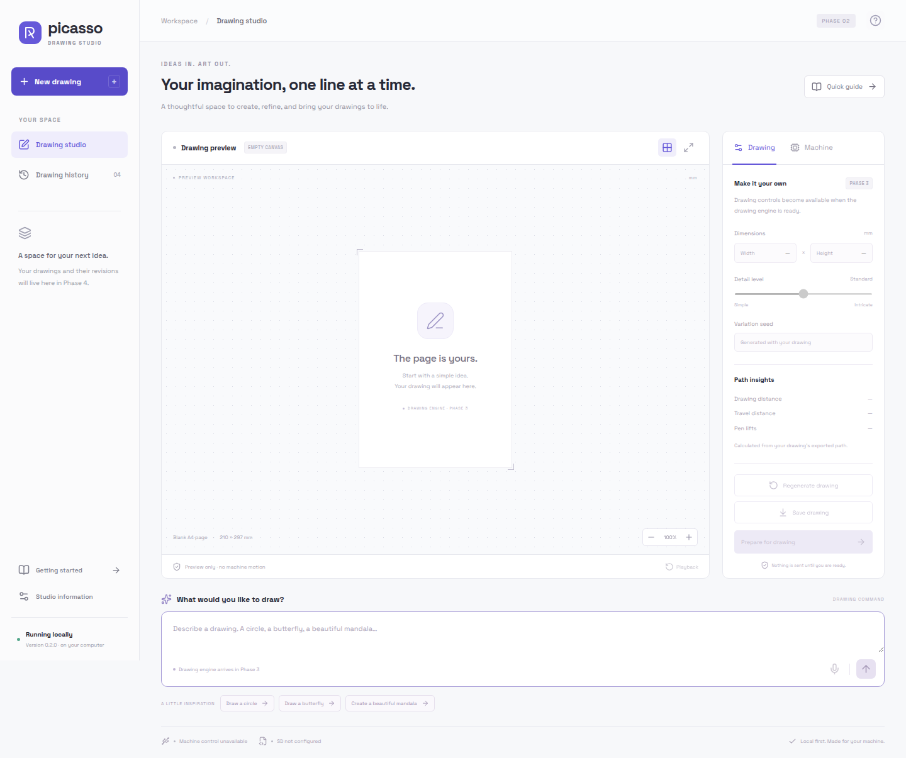

# Project Picasso

A local application being developed to turn drawing commands into previewed, machine-compatible paths for an Arduino wall drawing machine.

**Current milestone: Phase 2 complete — a runnable local studio, backend APIs, shared typed contracts, installer and single-command launcher. Drawing generation, G-code export, durable history, SD synchronization, AI and USB control remain scheduled for later phases.**

## Install and launch

Prerequisites: **Python 3.12+**, **Node.js 22.12+**, and npm. Linux was tested with Python 3.14.4, Node 22.22.1 and npm 9.2.0. macOS and Windows have not been verified. Node/npm are needed for setup and development; the built app runs through the project Python environment.

From the project root, install once:

```bash
python3 scripts/setup.py
```

This creates `.venv/`, installs the exact versions in `backend/requirements.lock` and `frontend/package-lock.json`, generates TypeScript contracts, and builds the interface. First setup needs internet access to the public Python/npm registries. Dependencies and caches stay in this project. On Debian/Ubuntu, a missing `venv`/`ensurepip` error means the matching `python3-venv` package needs to be installed first.

Then launch with one command:

```bash
python3 scripts/picasso.py
```

The launcher opens **http://127.0.0.1:8000** after the backend is ready. Keep the terminal running; **Ctrl+C** stops the service. It binds only to the local computer. No Arduino, SD card, AI key or cloud account is required. After setup, the app and its fonts load without internet access.

Useful options:

```bash
python3 scripts/picasso.py --no-browser
python3 scripts/picasso.py --port 8001
python3 scripts/picasso.py --dev
```

Development mode opens Vite at **http://127.0.0.1:5173**, proxies `/api` to the backend and reloads frontend/backend code. Use `--frontend-port 5174` if needed. Built mode serves the compiled UI and API from one process/origin. If a port is occupied, the launcher exits with an explanation; it does not stop another service or open an unrelated page.

Rebuild after source changes without reinstalling dependencies:

```bash
python3 scripts/setup.py --skip-install
```

## What works now

- Responsive drawing studio, command composer and example command shortcuts.
- Blank A4 preview workspace with functional grid/zoom controls; it is not a calibrated machine envelope.
- Read-only inspection of both source calibration references, with no active or verified machine profile.
- Live local-service health, separate unavailable machine/card states, offline error handling and reconnect without losing the command.
- Getting-started and studio-information dialogs, keyboard submission, and an application error boundary.
- Disabled microphone, drawing adjustments and export controls with their future phase identified.

Submitting a command currently returns **HTTP 501 / `GENERATION_UNAVAILABLE`** and an explanation. It does not generate a drawing, save history, write a card or move hardware. Phase 3 implements offline shapes/mandalas, adjustment and compatible G-code.



## Start here

- [Development plan](docs/DEVELOPMENT_PLAN.md): ordered implementation tasks, dependencies, tests, and completion gates for every phase.
- [Architecture](docs/ARCHITECTURE.md): stack, UI, services, data models, storage, and device state.
- [Firmware audit](docs/FIRMWARE_AUDIT.md): pin map, rope geometry, parser behavior, defects, and hardware questions.
- [Assets and SD audit](docs/ASSETS_AND_SD_AUDIT.md): existing drawings, legacy generation tools, manuals, and transfer options.
- [G-code contract](docs/GCODE_CONTRACT.md): the restricted export format required by the existing firmware.
- [Phase 1 report](docs/PHASE_1_REPORT.md): completed work, verification results, and outstanding hardware checks.
- [Phase 2 report](docs/PHASE_2_REPORT.md): implemented application features, test results, and current limits.
- [Third-party notices](docs/THIRD_PARTY_NOTICES.md): bundled font and package provenance.

## Development checks

Backend, original audit and real launcher/proxy tests:

```bash
.venv/bin/python -m pytest -q
```

Frontend checks, from `frontend/`:

```bash
npm run contracts:check
npm run typecheck
npm test
npm run build
```

When backend models change, regenerate the committed JSON schema and TypeScript definitions with `npm run contracts` in `frontend/`. The drift check fails if either is stale.

Optional browser tests, also from `frontend/`:

```bash
npx playwright install chromium
npm run test:e2e
```

Browser installation is only needed for the tests. To use an existing compatible Chromium installation, set `PICASSO_BROWSER_PATH` to its executable path. Browser tests start and stop their own app on port 8765 and save desktop/mobile screenshots under `docs/screenshots/`. They need loopback access and permission to launch a headless browser. The original audit command below remains dependency-free.

## Local API

Read-only foundation endpoints:

- `GET /api/health`: service version, instance, Python version and frontend-build presence.
- `GET /api/capabilities`: available features and reasons/phases for unavailable ones.
- `GET /api/status`: independent machine/card state; no device discovery is performed yet.
- `GET /api/profiles`: the two unverified references, with `active_profile_id: null`.

`POST /api/drawings/generate` validates the command and returns explicit unavailability in this phase. Interactive API documentation is at **http://127.0.0.1:8000/docs** while the service runs. The backend rejects unexpected hosts/origins. There are no file-write, serial-connect or motion endpoints yet.

## Run the Phase 1 audit

From the project root, with Python 3.10 or newer:

```bash
python3 -B scripts/audit_project.py
```

No packages, API keys, network access, Arduino, or SD reader are required. This command reads the original project files and prints their inventory. It does not generate a drawing or communicate with hardware.

Verify that all original files still match the Phase 1 baseline:

```bash
python3 -B scripts/audit_project.py --verify docs/project-inventory.json
```

Run the audit tests:

```bash
python3 -B -m unittest discover -s tests -p test_audit_project.py -v
```

Regenerate a report intentionally after changing source assets:

```bash
python3 -B scripts/audit_project.py --output docs/project-inventory.json
```

The report contains a SHA-256 manifest of all 543 original files and lexical statistics for the 26 drawing-code files, including the logo stored as `.txt`. Statistics are not a certificate that an input file is safe to draw.

## Existing hardware and files

The actual folder is `SdCard/` (case-sensitive), rather than `sdcard/`. It is a local collection of SD contents, not a detected mounted card.

`WallDrawingMachine.ino` is **empty**. Non-empty reference firmware exists at:

- `Drawbot_C/02 arduino code/Walldraw/Walldraw.ino` — motor separation 350 mm.
- `SdCard/02 arduino code/Walldraw/Walldraw.ino` — motor separation 400 mm.

Neither version has been established as the firmware installed on the machine. Both use the on-device menu to read `main.nc` from the physical card's root. They do not accept drawing commands over USB. The original files, including the current `SdCard/main.nc`, have been preserved.

## Next phases

The implemented stack is React + TypeScript + Vite with Python + FastAPI/Pydantic. SQLite persistence is planned for Phase 4 and pySerial for Phase 6; neither is used by the current dashboard. Arduino CLI is not installed. Current Vite runtime requirements are described in the [official Vite guide](https://vite.dev/guide/).

Next: implement Phase 3 from `docs/DEVELOPMENT_PLAN.md`, adding deterministic offline drawing commands and the restricted exporter. No paid AI service will be required for the supported shapes and mandalas. Hardware calibration and firmware changes remain separate milestones.
