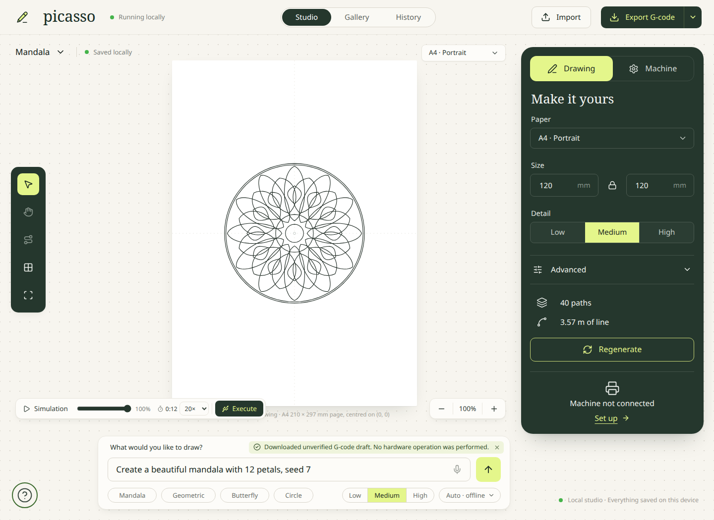
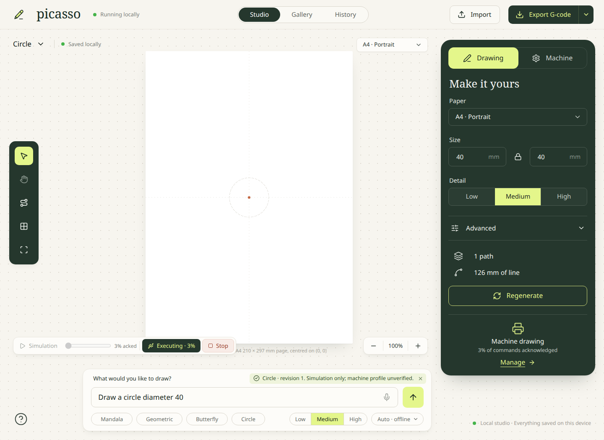

# Project Picasso

A local application being developed to turn drawing commands into previewed, machine-compatible paths for an Arduino wall drawing machine.

**Current milestone: Phase 6 software complete.** Press **Execute** beside *Simulation* to draw the previewed drawing over USB: the studio streams a verified job one acknowledged command at a time, with pause, stop and a firmware host-loss watchdog (serial protocol v1, firmware 0.6.1). The SD card can stay in the Arduino. The UNO runs a USB-only build that fits its memory (87% flash, 64% SRAM). It builds on the Phase 5 canonical firmware and the Phase 4 history, import, preparation and verified SD export. All of this is tested against simulated devices only. **Still pending:** real-card readback, physical commissioning and the hardware USB checks. **Voice input** (offline Faster-Whisper) is available early from Phase 8. **Optional AI line art** (Phase 7): requests the offline shapes cannot draw are sent to the OpenAI Image API and the returned picture is traced locally. See [AI drawing](#ai-drawing-optional).

## Install and launch

Prerequisites: **Python 3.12+**, **Node.js 22.12+**, and npm. Linux was tested with Python 3.14.4, Node 22.22.1 and npm 9.2.0. macOS and Windows have not been verified. Node/npm are needed for setup and development; the built app runs through the project Python environment.

From the project root, install once:

```bash
python3 scripts/setup.py
```

This creates `.venv/`, installs the exact versions in `backend/requirements.lock` and `frontend/package-lock.json`, downloads the offline speech model (Faster-Whisper *small*, about 480 MB, into `models/`), generates TypeScript contracts, and builds the interface. Add `--no-voice` to skip the model; the microphone button then explains that it is not installed. First setup needs internet access to the public Python/npm registries. Dependencies and caches stay in this project. On Debian/Ubuntu, a missing `venv`/`ensurepip` error means the matching `python3-venv` package needs to be installed first.

Then launch with one command:

```bash
python3 scripts/picasso.py
```

The launcher opens **http://127.0.0.1:8000** after the backend is ready. Keep the terminal running; **Ctrl+C** stops the service. It binds only to the local computer. No Arduino, SD card, AI key or cloud account is required; an OpenAI key only adds [AI drawing](#ai-drawing-optional). After setup, the app and its fonts load without internet access.

Useful options:

```bash
python3 scripts/picasso.py --no-browser
python3 scripts/picasso.py --port 8001
python3 scripts/picasso.py --dev
```

Development mode opens Vite at **http://127.0.0.1:5173**, proxies `/api` to the backend and reloads frontend/backend code. Use `--frontend-port 5174` if needed. Built mode serves the compiled UI and API from one process/origin. If a port is occupied, the launcher exits with an explanation; it does not stop another service or open an unrelated page.

Rebuild after source changes without reinstalling dependencies:

```bash
python3 scripts/setup.py --skip-install
```

## What works now

- Responsive drawing studio, command composer and example command shortcuts.
- Offline circles/ellipses, rectangles, spirals, butterflies, mandalas and geometric patterns, generated without an API key.
- Live size/aspect lock, rotation, placement, detail, seed and generator-specific controls; seed locking and regeneration.
- SVG preview derived from the exact exported G-code, with zoom/grid, travel toggle, simulation playback, actual bounds, path distances and pen lifts.
- Durable immutable revisions, searchable history with thumbnails, integrity checks/repair, and JSON/SVG/restricted G-code downloads.
- Import an image (PNG, JPG, WEBP, BMP or TIFF): OpenCV traces it into travel-ordered line art at Low, Medium or High detail, fitted to the page. Or import existing absolute-mm linear G-code (format detected automatically), which keeps its own coordinates and original-bounds provenance.
- Inspect both source references and record/edit actual machine measurements; no physical profile is selected or verified automatically.
- Freeze a drawing into a prepared job; validate its full path and initial travel against the verified measured profile.
- Back up and stage local `SdCard/main.nc`, or copy to an explicitly selected mounted FAT card with checksum readback.
- Test the same publication pipeline in an isolated app-owned directory without hardware; opt into syncing one exact prepared job when its approved target is available.
- Live local-service health, separate unavailable machine/card states, offline error handling and reconnect without losing the command.
- Getting-started and studio-information dialogs, keyboard submission, and an application error boundary.
- Physical preparation stays disabled until the selected measured profile is verified.
- **Voice input:** click the microphone, say *“Draw a butterfly”*, and the words appear in the command box. See [Voice input](#voice-input).
- **Optional AI drawing:** with an OpenAI key, *“Draw a cat on a skateboard”* becomes AI line art, traced locally at Low, Medium or High detail into the same preview, simulation and Execute pipeline. See [AI drawing](#ai-drawing-optional).
- **Canonical firmware** in `firmware/WallDrawingMachine/` keeps the original pins, libraries and step sequence. It adds a bounded strict parser, validation of the whole file and workspace before any motion, a deliberate per-job origin, cooperative pause/stop, pen settling both ways, coil holding and distinct completed/aborted/failed results. See [the firmware README](firmware/README.md).
- **USB control**: list ports without opening them; connect explicitly; verify firmware, configuration ID, boot session, origin and position; then stream a verified physical job one acknowledged command at a time, with pause, resume, stop, live acknowledged progress and a validated *Go to origin*. Runs are recorded locally. Restarts and resets never resume. See the [serial protocol](docs/SERIAL_PROTOCOL.md).
- **Execute** beside *Simulation*: one sheet connects the machine, checks the verified profile, the drawing's workspace fit and the keypad origin, asks you to confirm the area is clear, then draws over USB. The preview shows acknowledged progress, the commanded position and an always-visible **Stop**.
- Machine measurements that differ from both reference sketches can be verified by generating `machine_config.h` from the profile, uploading it, and entering the configuration ID the machine displays. Prepared jobs show the CRC-32 the firmware displays after checking `main.nc`.

Try **“Draw a beautiful mandala”**, **“Draw a butterfly”**, or **“Draw a circle diameter 100”**. You can also specify `120 mm wide`, `100 x 60 mm`, `12 petals`, `5 turns`, `symmetry 8`, `seed 7`, and `simple`/`standard`/`intricate`, where applicable. Unsupported or ambiguous commands explain the supported grammar. See [offline commands and draft workflow](docs/OFFLINE_DRAWING_COMMANDS.md).

Draft previews and downloads remain **unverified for execution**. Physical preparation requires operator-recorded calibration, workspace/rope limits and pen/holding checks matching either a bundled legacy sketch or canonical firmware generated from that profile (proved by its configuration ID). The app checks geometry and file bytes; it does not measure carriage position or certify physical safety. Every SD job requires the recorded manual `(0,0)` origin procedure before starting it from the machine's menu. The machine moves only through an explicitly started USB run (Execute → confirm → Start) or the keypad.

To try Phase 4 without hardware: generate a drawing → open the menu beside **Export G-code** → **Test export without hardware** → prepare a simulation job → create the test directory → review replacement → export. The destination is `data/test-card/main.nc`, clearly labeled as a test. Physical-card discovery/export currently supports Linux/POSIX; the card must be mounted in the computer. Arduino USB does not expose its SPI card. See the [storage and commissioning guide](docs/STORAGE_AND_COMMISSIONING.md) for the physical workflow, backups and automatic-sync limits.

History lives under `data/` and survives restarts. Its SQLite database and checksummed artifacts are local to this computer; stop the app before backing up the entire directory. The browser's eight recently viewed entries are shortcuts, not the history retention limit.



## Voice input

1. Click the **microphone** in the command box. The browser asks for microphone permission the first time.
2. Say one command, for example *“Draw a butterfly”* or *“Create a mandala with 12 petals, 120 mm wide”*. A pause of about a second ends the recording; you can also click the button again. **Esc** cancels. Recordings are limited to 30 seconds.
3. The recognized words are inserted at the cursor (replacing any selected text). Review or edit them, then press **Enter**.

Voice only fills the command box. It never generates a drawing, prepares a job or moves the machine; those keep their own explicit controls. Speech is recognized on this computer by Faster-Whisper *small* (CPU, int8): audio goes only to the local service, is not stored, and no network is used after setup. The model loads in the background when you first press the microphone, so the first command takes a moment longer. Spoken units are converted to the command grammar (“millimeters” → `mm`, “100 by 60” → `100 x 60`).

A model at a different location can be used with `PICASSO_VOICE_MODEL_DIR`. To install the model later: `.venv/bin/python -m backend.app.voice download`; to check it: `.venv/bin/python -m backend.app.voice check`. The browser must support `MediaRecorder` (current Chrome, Edge, Firefox and Safari); microphone access works on `127.0.0.1`/`localhost` without HTTPS. Tested on Linux with Chromium; real-microphone tests on other browsers/operating systems are pending.

## AI drawing (optional)

Commands are routed by cost and speed:

| Request | Engine | Network | Cost |
| --- | --- | --- | --- |
| Circle, ellipse, rectangle, spiral, butterfly, mandala, geometric pattern | Offline Python generators | None | Free |
| Anything else (*“a lighthouse on a cliff”*) | OpenAI Image API → OpenCV trace on this computer | One request | Billed to your key |
| Speech | Faster-Whisper on this computer | None | Free |

To enable it, copy `.env.example` to `.env` (git-ignored), set `OPENAI_API_KEY`, and restart the launcher. The default model is `gpt-image-2.5-flare`, OpenAI's fast everyday image model; set `PICASSO_OPENAI_IMAGE_MODEL` to change it, or `PICASSO_AI=off` to disable AI even with a key present. A real environment variable takes precedence over `.env`.

Below the command box, choose the detail and the engine:

- **Low / Medium / High** sets the offline generator detail (a word in the command, such as “intricate”, still wins). For AI it sets both OpenAI's rendering quality (time and cost) and the tracing level.
- **Auto** (default) draws supported shapes offline and sends only commands the offline grammar cannot draw at all to OpenAI. A supported shape with a bad value (“2 petals”) is reported, not sent. **Offline only** never uses the network. **AI image** always asks OpenAI.

What is sent: the command text inside a fixed line-art style instruction. Only an image comes back. It is traced into paths by the same OpenCV code as **Import → Image**, then regenerated, bounded and validated like every drawing; provider output is never executed. The drawing is fitted to 85% of the selected paper, saved in history with its model, quality, prompt and image checksum (never the key), and stays a draft: it is never prepared or drawn until you press **Execute** and confirm. AI drawings can be resized, rotated and moved locally for free; for a different picture, submit the command again. One AI request runs at a time; **Cancel** returns at once, but OpenAI may still bill a request it has already received.

The key is read only by the local backend. It is never sent to the browser, logged, written to history or included in error messages. Errors (invalid key, no quota, rate limit, content policy, timeout, offline) explain themselves, and offline shapes keep working.

## Draw from the studio over USB

Setup, once per machine:

1. **Linux port access:** run `sudo usermod -aG dialout $USER`, then log out and back in. Close the Arduino IDE Serial Monitor; only one program can hold the port.
2. **Profile:** in **Machine → Record / edit measurements**, enter your measurements, choose *Picasso canonical firmware* and save.
3. **Firmware:** generate the header, check that the build fits, then upload it with the motor supply off. See the [firmware README](firmware/README.md).

   ```bash
   python3 scripts/firmware.py config --profile <profile-id>   # writes machine_config.h
   python3 scripts/firmware.py build --profile <profile-id>    # USB-only UNO build with memory report
   ```

   Upload from the Arduino IDE, which builds the USB-only firmware by default, or with the arduino-cli command in the firmware README.
4. **Verify:** read the configuration ID on the machine's *Info* screen, enter it in the profile, tick the checks and mark the profile verified.

Every drawing:

1. Generate or open a drawing, then press **Execute** next to *Simulation*.
2. Choose the Arduino's port (`/dev/ttyUSB0` for a CH340 UNO) and connect. Connecting resets an UNO, so then choose **Setup → Set origin** on the keypad with the pen at the origin.
3. Tick *The drawing area is clear* and press **Start drawing**. Watch progress on the preview. **Stop** in the studio or ESC on the keypad always stops.
4. Between drawings, use **Go to origin** in the sheet; nothing travels implicitly.



## Start here

- [Development plan](docs/DEVELOPMENT_PLAN.md): ordered implementation tasks, dependencies, tests, and completion gates for every phase.
- [Architecture](docs/ARCHITECTURE.md): stack, UI, services, data models, storage, and device state.
- [Firmware audit](docs/FIRMWARE_AUDIT.md): pin map, rope geometry, parser behavior, defects, and hardware questions.
- [Assets and SD audit](docs/ASSETS_AND_SD_AUDIT.md): existing drawings, legacy generation tools, manuals, and transfer options.
- [G-code contract](docs/GCODE_CONTRACT.md): the restricted export format required by the existing firmware.
- [Phase 1 report](docs/PHASE_1_REPORT.md): completed work, verification results, and outstanding hardware checks.
- [Phase 2 report](docs/PHASE_2_REPORT.md): implemented application features, test results, and current limits.
- [Phase 3 report](docs/PHASE_3_REPORT.md): drawing engine, export, preview and validation results.
- [Phase 4 report](docs/PHASE_4_REPORT.md): durable storage, import, preparation, transfer tests and remaining hardware checks.
- [Storage and commissioning guide](docs/STORAGE_AND_COMMISSIONING.md): test exports, profiles, mounted cards, backups and recovery.
- [Phase 5 report](docs/PHASE_5_REPORT.md): canonical firmware, configuration reconciliation, host tests and pending hardware checks.
- [Phase 6 report](docs/PHASE_6_REPORT.md) and [serial protocol](docs/SERIAL_PROTOCOL.md): USB streaming, fault handling, simulated-device tests and serial permissions.
- [Firmware README](firmware/README.md) and [commissioning guide](docs/FIRMWARE_COMMISSIONING.md): build/upload, keypad operation and the physical check sequence.
- [Third-party notices](docs/THIRD_PARTY_NOTICES.md): bundled font and package provenance.

## Development checks

Backend, original audit and real launcher/proxy tests:

```bash
.venv/bin/python -m pytest -q
```

Frontend checks, from `frontend/`:

```bash
npm run contracts:check
npm run typecheck
npm test
npm run build
```

Firmware host checks (needs `g++`; included in the pytest run above):

```bash
python3 scripts/firmware.py host-test
```

Firmware compile with flash/SRAM report (needs Arduino CLI 1.3.1 and `arduino-cli core install arduino:avr@1.8.6`; CI runs the reference and synthetic-workspace builds):

```bash
python3 scripts/firmware.py build --reference reference-350
python3 scripts/firmware.py build --profile <measured-profile-id> --fqbn <your-board-fqbn>
```

When backend models change, regenerate the committed JSON schema and TypeScript definitions with `npm run contracts` in `frontend/`. The drift check fails if either is stale.

Optional browser tests, also from `frontend/`:

```bash
npx playwright install chromium
npm run test:e2e
```

Browser installation is only needed for the tests. To use an existing compatible Chromium installation, set `PICASSO_BROWSER_PATH` to its executable path. Rebuild before browser tests (`npm run build`). Browser tests start and stop their own app on port 8765 using isolated temporary data/mirror directories and save desktop/mobile screenshots under `docs/screenshots/`. They need loopback access and permission to launch a headless browser. The original audit command below remains dependency-free.

## Local API

The running application exposes its full schema at **http://127.0.0.1:8000/docs**. Main endpoints:

- `GET /api/health`, `/api/capabilities`, `/api/status`: independent application, machine and storage state.
- `GET /api/profiles`: source references, saved measured profiles and active selection.
- `GET /api/drawings?query=mandala&offset=0&limit=20`: searchable persistent history.
- `POST /api/drawings/generate` (`{prompt, mode: auto|offline|ai, detail: low|medium|high, fit_width_mm, fit_height_mm}`), `POST /api/drawings/import`: generate/import and save a draft. Only `auto`/`ai` with a configured key can contact OpenAI.
- `POST /api/drawings/{revision_id}/revisions`: save an immutable adjustment/regeneration.
- `POST /api/voice/transcribe` (raw recorded audio body) → `{text, duration_s, processing_s}`; `POST /api/voice/warm` loads the speech model in the background. Text only; nothing is generated.
- `GET /api/drawings/{revision_id}` and `/export?format=json|svg|gcode`: retrieve exact saved artifacts.
- `POST /api/profiles`, `PUT /api/profiles/{id}`, `POST /api/profiles/select`: measured calibration with revision checking.
- `GET /api/machine/ports`, `GET /api/machine`, `POST /api/machine/connect|disconnect|home|pause|resume|stop`: explicit USB session and controls. Only listed ports can be opened.
- `POST /api/jobs/{id}/usb-start`: bind a verified physical job to the displayed boot session, origin revision and configuration, then stream it.
- `GET /api/profiles/{id}/firmware-config`: download the generated `machine_config.h` for a measured or reference profile (header `X-Picasso-Firmware-Config-Id`). Nothing is uploaded.
- `POST /api/jobs/prepare`, `GET /api/jobs/{id}`: freeze/restore a validated job.
- `GET /api/storage/targets`, `POST /api/storage/select`, `POST /api/storage/test-target`: explicit destination discovery/selection.
- `POST /api/jobs/{id}/stage`, `POST /api/jobs/{id}/sd-export`: reviewed local-mirror staging or verified selected-target export.
- `POST /api/storage/auto-sync`, `GET /api/storage/transfers`: exact-job automatic export and durable transfer records.
- `POST /api/artifacts/{id}/repair`: restore a damaged artifact from its checksummed database recovery copy.

All mutations require `X-Picasso-Token`, obtained from `GET /api/session`; it changes on service restart. The browser handles this automatically. API clients must fetch the token and include the header; `/docs` shows the request schemas but does not attach it automatically. Unexpected hosts/origins are rejected. Motion happens only through an explicitly started USB run or the explicit, firmware-validated *Go to origin*. Generation retains cooperative cancellation, complexity limits and two concurrent workers.

## Run the Phase 1 audit

From the project root, with Python 3.10 or newer:

```bash
python3 -B scripts/audit_project.py
```

No packages, API keys, network access, Arduino, or SD reader are required. This command reads the original project files and prints their inventory. It does not generate a drawing or communicate with hardware.

Verify that all original files still match the Phase 1 baseline (a later deliberate managed `SdCard/main.nc` export will change that one file):

```bash
python3 -B scripts/audit_project.py --verify docs/project-inventory.json
```

Run the audit tests:

```bash
python3 -B -m unittest discover -s tests -p test_audit_project.py -v
```

Regenerate a report intentionally after changing source assets:

```bash
python3 -B scripts/audit_project.py --output docs/project-inventory.json
```

The report contains a SHA-256 manifest of all 543 original files and lexical statistics for the 26 drawing-code files, including the logo stored as `.txt`. Statistics are not a certificate that an input file is safe to draw.

## Existing hardware and files

The actual folder is `SdCard/` (case-sensitive), rather than `sdcard/`. It is a local collection of SD contents, not a detected mounted card.

`WallDrawingMachine.ino` is **empty**. Non-empty reference firmware exists at:

- `Drawbot_C/02 arduino code/Walldraw/Walldraw.ino` — motor separation 350 mm.
- `SdCard/02 arduino code/Walldraw/Walldraw.ino` — motor separation 400 mm.

Neither version has been established as the firmware installed on the machine. Both use the on-device menu to read `main.nc` from the physical card's root. They do not accept drawing commands over USB. The original files, including the current `SdCard/main.nc`, have been preserved.

The maintained sketch is `firmware/WallDrawingMachine/WallDrawingMachine.ino`; the root file stays an empty placeholder. Canonical firmware rejects the raw vendor samples (including the current `SdCard/main.nc`) before any motion. Import them in the studio and export a fresh job.

## Next phases

The implemented stack is React + TypeScript + Vite with Python + FastAPI/Pydantic, standard-library geometry/export, SQLite plus immutable files, and C++11 Arduino firmware with a host test harness. USB access uses pySerial 3.5.

Pending hardware acceptance: the Arduino CLI compile and memory report on the actual board, real-card readback (Phase 4) and the [commissioning checks](docs/FIRMWARE_COMMISSIONING.md). Pending hardware acceptance also includes the Phase 6 USB checks (commissioning guide §10). Next: the rest of Phase 7 (a documented prompt set checked against the real provider, follow-up adjustments such as “make it smaller”), then the rest of Phase 8 (release polish and real-microphone tests across browsers). AI tests use a mocked provider only.
